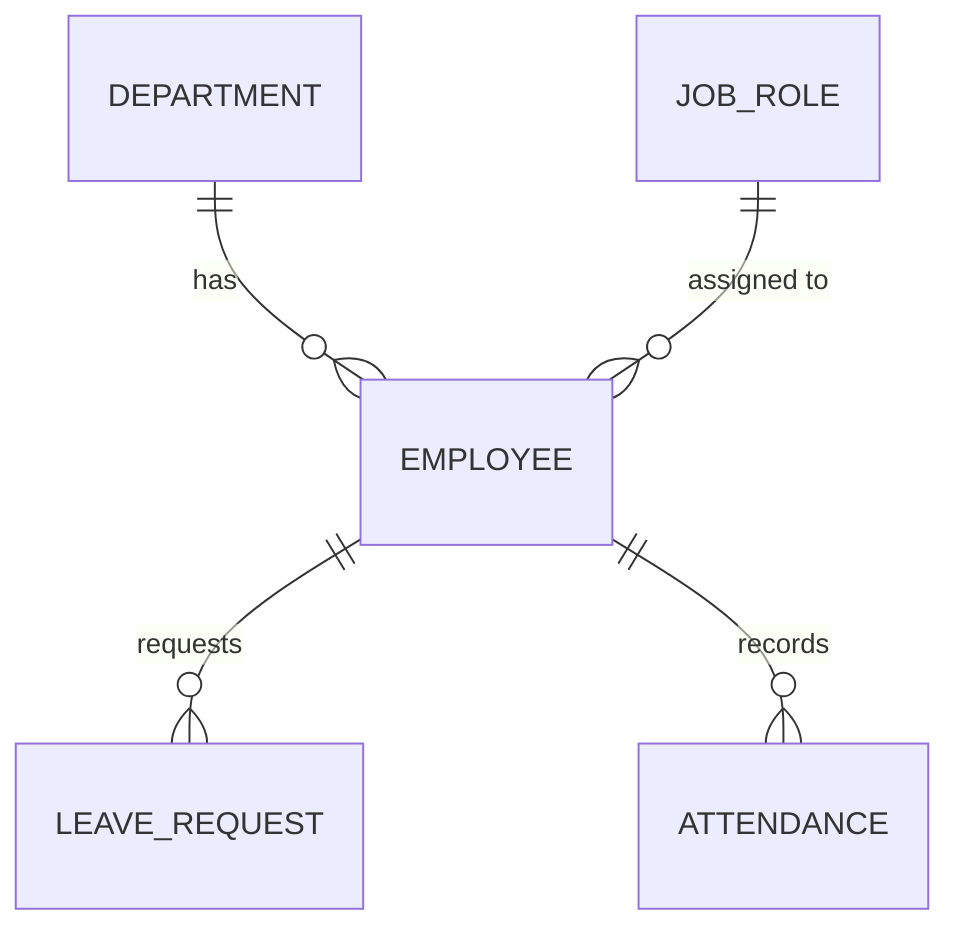

# TeamForge: Employee Management ERP

A REST API backend for managing employees, departments, job roles, leave requests and attendance. Built with Spring Boot and MySQL using a layered architecture, with validation, consistent error handling, pagination and business rules enforced in the service layer.

> **Status:** In active development. Phases 1 and 2 are complete. Security (JWT and roles) and an approval workflow engine are next. See the [Roadmap](#roadmap).

## Tech stack

| Area | Technology |
|---|---|
| Language | Java 21 |
| Framework | Spring Boot 4.1 (Spring Web, Spring Data JPA, Bean Validation) |
| Database | MySQL |
| ORM | Hibernate / JPA |
| API docs | springdoc-openapi (Swagger UI) |
| Build tool | Maven |

## Features

- **Employees**: full CRUD with validation, unique email, search by name or email, filter by department, sorting and pagination
- **Departments**: CRUD, unique names, deletion blocked while employees belong to the department
- **Job roles**: lookup table with optional salary bands. An employee's salary is validated against their role's band.
- **Leave requests**: apply, approve, reject and cancel, driven by a status state machine (`PENDING`, `APPROVED`, `REJECTED`, `CANCELLED`) with overlap detection
- **Attendance**: daily check-in and check-out with automatic hours calculation, one record per employee per day, and a check that blocks check-in during approved leave
- **Consistent errors**: every failure returns clean JSON with a meaningful HTTP status (400, 404, 405, 409)
- **Data protection**: employees, departments and job roles with dependent records can't be deleted, so history is never orphaned

## Architecture

The request flow follows the standard layers:

```
Client -> Controller -> Service -> Repository -> MySQL
              |            |
             DTOs     business rules
```

| Layer | Responsibility |
|---|---|
| **Controller** | Maps HTTP requests to service calls and returns status codes. No business logic. |
| **Service** | Business rules such as overlap checks, status transitions, salary bands and existence checks |
| **Repository** | Spring Data JPA interfaces and JPQL queries |
| **Entity** | JPA classes mapped to tables |
| **DTO** | Java records that define exactly what the API accepts and returns, so entities are never exposed |
| **Exception** | A global `@RestControllerAdvice` handler that turns exceptions into JSON errors |

### Data model



### Project structure

```
src/main/java/com/erpProject/teamforge
├── controller   REST endpoints
├── service      business logic
├── repository   data access
├── entity       JPA entities and enums
├── dto          request and response records
└── exception    custom exceptions and global handler
```

## Getting started

### Prerequisites
- Java 17 or newer (21 recommended)
- Maven (or use the included `mvnw` wrapper)
- MySQL 8 or newer

### 1. Clone the repository
```bash
git clone https://github.com/Prithviraj-Singh0268/Employee_CRUD.git
cd Employee_CRUD
```

### 2. Create the database
```sql
CREATE DATABASE teamforge;
```

### 3. Configure the connection
In `src/main/resources/application.properties`:

```properties
spring.datasource.url=jdbc:mysql://localhost:3306/teamforge
spring.datasource.username=${DB_USERNAME:root}
spring.datasource.password=${DB_PASSWORD}

spring.jpa.hibernate.ddl-auto=update
spring.jpa.show-sql=true
```

Set the `DB_PASSWORD` environment variable (and optionally `DB_USERNAME`) before running. Credentials are never committed to the repository.

### 4. Run
```bash
./mvnw spring-boot:run
```
On Windows: `mvnw.cmd spring-boot:run`

The API starts at `http://localhost:8080`, and Hibernate creates the tables on first run.

### 5. Explore the API
Open **Swagger UI** at `http://localhost:8080/swagger-ui.html` to try every endpoint from the browser. Raw OpenAPI JSON is at `/v3/api-docs`.

## API reference

### Employees: `/api/employees`

| Method | Endpoint | Description | Success |
|---|---|---|---|
| POST | `/api/employees` | Create an employee | 201 |
| GET | `/api/employees` | Paginated list with search, filter and sort | 200 |
| GET | `/api/employees/{id}` | Get one employee | 200 |
| PUT | `/api/employees/{id}` | Update an employee | 200 |
| DELETE | `/api/employees/{id}` | Delete (blocked if leave or attendance exists) | 204 |

**List query parameters** (all optional):

| Parameter | Default | Description |
|---|---|---|
| `keyword` | none | Matches first name, last name or email (case-insensitive) |
| `departmentId` | none | Filter by department |
| `page` | 0 | Zero-based page number |
| `size` | 10 | Page size (1 to 100) |
| `sortBy` | `id` | One of `id`, `firstName`, `lastName`, `email`, `salary`, `hireDate` |
| `direction` | `asc` | `asc` or `desc` |

Example:
```
GET /api/employees?keyword=asha&departmentId=1&sortBy=hireDate&direction=desc&page=0&size=5
```

Sample request body:
```json
{
  "firstName": "Asha",
  "lastName": "Verma",
  "email": "asha@company.com",
  "jobRoleId": 1,
  "salary": 60000,
  "hireDate": "2024-06-01",
  "departmentId": 1
}
```

### Departments: `/api/departments`

| Method | Endpoint | Description | Success |
|---|---|---|---|
| POST | `/api/departments` | Create | 201 |
| GET | `/api/departments` | List all | 200 |
| GET | `/api/departments/{id}` | Get one | 200 |
| PUT | `/api/departments/{id}` | Update | 200 |
| DELETE | `/api/departments/{id}` | Delete (blocked if it has employees) | 204 |

### Job roles: `/api/job-roles`

| Method | Endpoint | Description | Success |
|---|---|---|---|
| POST | `/api/job-roles` | Create (optional `minSalary` and `maxSalary`) | 201 |
| GET | `/api/job-roles` | List all, sorted by title | 200 |
| GET | `/api/job-roles/{id}` | Get one | 200 |
| PUT | `/api/job-roles/{id}` | Update | 200 |
| DELETE | `/api/job-roles/{id}` | Delete (blocked if employees hold it) | 204 |

### Leave requests: `/api/leave-requests`

| Method | Endpoint | Description | Success |
|---|---|---|---|
| POST | `/api/leave-requests` | Apply for leave (starts as `PENDING`) | 201 |
| GET | `/api/leave-requests` | Paginated list, filter by `employeeId` and `status` | 200 |
| GET | `/api/leave-requests/{id}` | Get one | 200 |
| PATCH | `/api/leave-requests/{id}/approve` | `PENDING` to `APPROVED` | 200 |
| PATCH | `/api/leave-requests/{id}/reject` | `PENDING` to `REJECTED` | 200 |
| PATCH | `/api/leave-requests/{id}/cancel` | `PENDING` or `APPROVED` to `CANCELLED` | 200 |

Leave types: `ANNUAL`, `SICK`, `CASUAL`, `UNPAID`.

```
PENDING --approve--> APPROVED --cancel--> CANCELLED
   |                                          ^
   +-----reject-----> REJECTED                |
   +------------------cancel------------------+
```

### Attendance: `/api/attendance`

| Method | Endpoint | Description | Success |
|---|---|---|---|
| POST | `/api/attendance/check-in` | Start today's attendance (`{"employeeId": 1}`) | 201 |
| POST | `/api/attendance/check-out` | End today's attendance and calculate hours | 200 |
| GET | `/api/attendance` | Paginated history. Filters: `employeeId`, `from`, `to` (`YYYY-MM-DD`, default last 30 days) | 200 |
| GET | `/api/attendance/{id}` | Get one record | 200 |

## Business rules

| Area | Rule |
|---|---|
| Employee | Email must be unique, including when updating |
| Employee | Salary must fall inside the job role's band, if the role has one |
| Employee | Can't be deleted while leave or attendance records exist |
| Leave | End date can't be before start date, and start date can't be in the past |
| Leave | An employee can't have overlapping `PENDING` or `APPROVED` leave |
| Leave | Only valid status transitions are allowed, otherwise **409 Conflict** |
| Attendance | One record per employee per day (enforced in the service and by a database unique constraint) |
| Attendance | Check-out requires a check-in, and a second check-in or check-out is rejected |
| Attendance | Check-in is blocked while the employee is on approved leave |

## Error responses

All errors are JSON.

```json
{ "error": "Employee not found with id 99" }
```

Validation errors list each failing field:

```json
{ "email": "must be a well-formed email address", "firstName": "must not be blank" }
```

| Status | Meaning |
|---|---|
| 400 | Invalid input, failed validation, or a business rule was broken |
| 404 | Resource or endpoint not found |
| 405 | HTTP method not supported for this URL |
| 409 | Valid request that conflicts with current state (for example approving an already-approved leave) |
| 500 | Unexpected server error (logged server-side, with no internals leaked to the client) |

## Design decisions

- **DTOs everywhere.** Entities never leave the service layer, so the API contract doesn't change when the database does.
- **Enums stored as strings** (`@Enumerated(EnumType.STRING)`) so reordering an enum can't silently corrupt data.
- **Whitelisted sort fields.** User-supplied sort columns are checked against an allowed set before reaching the data layer.
- **Bounded queries.** Page sizes are capped and attendance history defaults to 30 days, so no endpoint can return unbounded data.
- **Leave history is never deleted.** Requests are cancelled by changing status, which keeps an audit-friendly record.

## Roadmap

- [x] **Phase 1**: Employee and Department CRUD, validation, global exception handling, pagination, sorting, search, Swagger UI
- [x] **Phase 2**: Leave requests with a status workflow, attendance, job roles with salary bands
- [ ] **Phase 3**: Spring Security with JWT authentication and Admin, Manager and Employee roles
- [ ] **Phase 4**: Configurable approval workflow engine and audit log (who changed what, and when)
- [ ] **Phase 5**: Skills-based staffing (skills, proficiency levels, availability search)
- [ ] **Phase 6**: Frontend, automated tests, Docker, Flyway migrations and deployment

## Screenshots

_Swagger UI screenshot to be added here._

## Author

**Prithviraj Singh**
GitHub: [@Prithviraj-Singh0268](https://github.com/Prithviraj-Singh0268)
